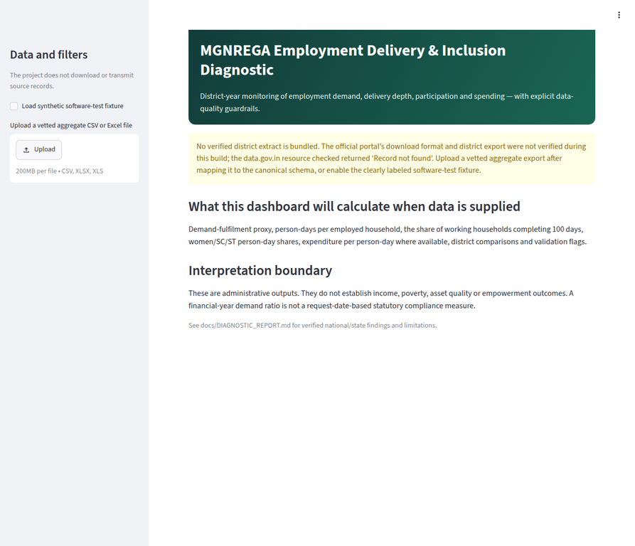
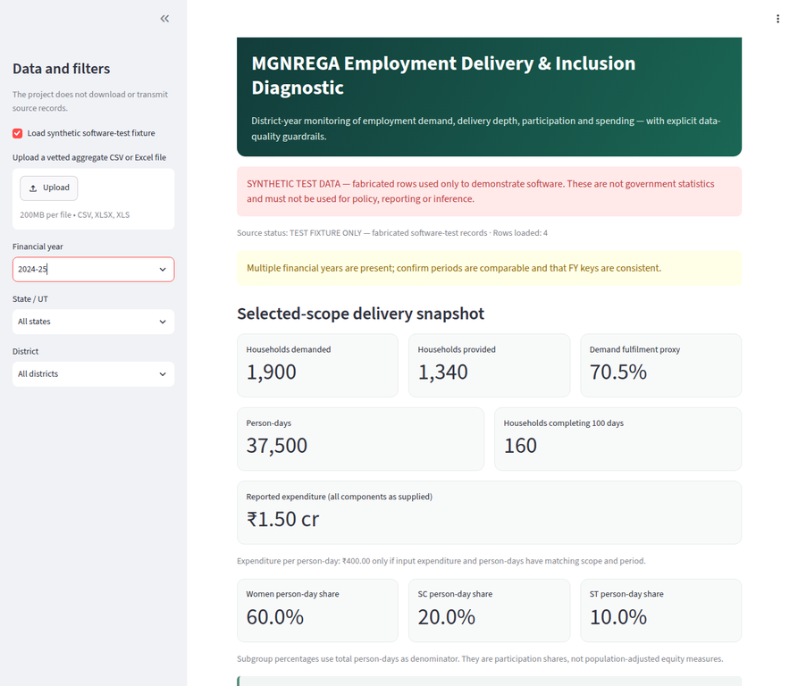
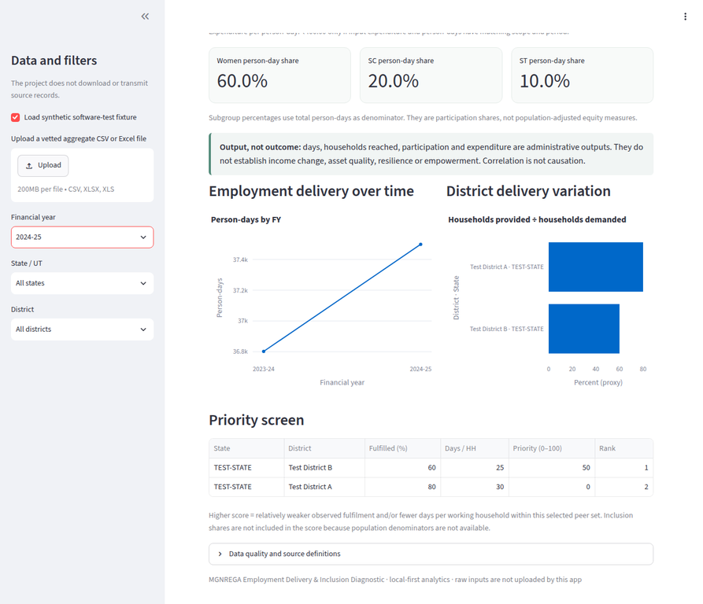

# MGNREGA Employment Delivery & Inclusion Diagnostic

A reproducible, local-first Python/pandas pipeline, SQLite store and Streamlit dashboard designed to diagnose rural employment delivery across Indian districts when a verified official MGNREGA extract is available.

## Evidence status

This build found no verifiable downloadable district panel. The Ministry’s public portal shows District as a reporting level, a Download data control, indicators for demand, employment, person-days, participation and expenditure, and visible FY selectors from 2022–23 through 2026–27. The report and download action did not yield district rows or a local file in this build. The data.gov.in search route returned 404, and the official resource page for “District-wise MGNREGA Data at a Glance” returned “Record not found.” Consequently, **no district-level statistics or rankings are presented**.

The official Department of Rural Development State Performance Report for FY 2024–25 does provide national/state context. It reports 58.1% women person-days, 18.63% SC person-days, 18.09% ST person-days, 40,66,631 households completing 100 days, and a reported 7% all-India completion share. These report values are discussed with their caveats in [`docs/DIAGNOSTIC_REPORT.md`](docs/DIAGNOSTIC_REPORT.md). They are not district findings and are not imported as district records.

**Scheme break:** the Government states that MGNREGA was repealed from 1 July 2026, when the successor VB-G RAM G Act commenced with a 125-day guarantee. FY 2026–27 crosses the change and is flagged; do not treat it as a clean MGNREGA year. [Official transition notice](https://www.pib.gov.in/FaqDetails.aspx?ModuleId=4&NoteId=158511&lang=1&reg=3).

## Dashboard capabilities

- Filters by FY, state and district when verified local data is supplied.
- Demand/provision counts and ratio, person-days, 100-day completion, women/SC/ST person-day shares and expenditure indicators where those columns exist.
- District comparisons, time trends and missingness/quality warnings.
- A transparent peer-relative investigation queue based on lower demand fulfilment and fewer person-days per employed household. It is not an audit score or causal estimate. Participation shares are displayed separately because population-adjusted denominators are absent.
- Explicit source status, units, formulas, validation warnings and a 2026–27 transition flag.
- Optional synthetic demo mode uses `TEST-STATE`/`Test District` rows and displays a prominent warning. It is for software testing only, not analysis or policy use.

## Dashboard screenshots

The blank-state screenshot shows the verified public-data access limitation. The other screenshots use the clearly marked, fabricated software-test fixture; **none of their values are government statistics**.







## Quick start on Windows

1. Install Python 3.10 or newer. In PowerShell, from the repository directory:

```powershell
py -3.11 -m venv .venv
.\.venv\Scripts\Activate.ps1
python -m pip install --upgrade pip
pip install -r requirements.txt
```

If PowerShell blocks activation, use `\.venv\Scripts\python.exe -m pip install -r requirements.txt` and prefix the commands below with `\.venv\Scripts\python.exe`.

2. Start the dashboard:

```powershell
streamlit run app.py
```

Open the local URL printed by Streamlit. With no data file, the app will show the verified data-access limitation and can optionally load the clearly labeled software-test fixture.

3. Run tests:

```powershell
python -m pytest
```

4. Prepare a vetted source file. Save the official aggregate export locally, not in Git. Inspect its original headers and sample rows first:

```powershell
python scripts/inspect_source.py .\data\raw\portal_export.csv
```

If the portal produces another format, note it before converting. The project importer accepts local CSV, XLSX and XLS, but this does **not** establish that the portal exports those formats. Map source fields explicitly to the canonical names in [`docs/DATA_DICTIONARY.md`](docs/DATA_DICTIONARY.md), preserving exact source definitions, units and period. Then run:

```powershell
python scripts/run_pipeline.py --input .\data\raw\district_panel_canonical.csv
streamlit run app.py
```

Generated cleaned CSV, SQLite database and ingest metadata go under `data/processed/`. Those files and all files in `data/raw/` are git-ignored. The pipeline never downloads data or uploads it to a service.

## macOS/Linux

```bash
python3 -m venv .venv
source .venv/bin/activate
python -m pip install --upgrade pip
pip install -r requirements.txt
python -m pytest
streamlit run app.py
```

## Canonical fields and validation

Required columns are `fy`, `state`, `district`, `households_demanded`, `households_provided`, and `persondays_generated`. Optional fields are `households_100_days`, `women_persondays`, `sc_persondays`, `st_persondays` and `expenditure_rs`. Header punctuation/case is normalized; no ambiguous labels are guessed. Duplicate geography-period keys, negative counts, blank keys and invalid numeric values stop processing. Missing optional values remain missing. Overprovided households, impossible subgroup totals, and transition periods are warnings to investigate.

See [`docs/DATA_DICTIONARY.md`](docs/DATA_DICTIONARY.md), [`docs/METHODOLOGY.md`](docs/METHODOLOGY.md) and [`docs/SOURCE_REGISTER.md`](docs/SOURCE_REGISTER.md) for formulas, legal/date context, source checks, definitions and quality limits.

## Interpretation guardrails

Recorded demand, households reached, days, participation and expenditure are programme outputs. They do not establish household income, poverty reduction, asset quality or empowerment. Aggregate ratios are not statutory time-compliance tests. District associations are descriptive, not causal. The available official summary is not a substitute for raw district-month records and source metadata.

## Repository privacy

Only source code, documentation, test code and explicitly fabricated software-test rows belong in version control. Do not commit raw exports, worker/job-card records, local databases, tokens or credentials. See `.gitignore`.
